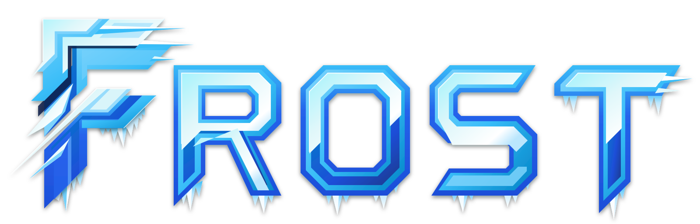

<p align="center">
  
</p>

# Frost ❄️

> Modular, Declarative NixOS Starter Framework & Flake Distribution

Frost is an opinionated, modular NixOS framework and starter distribution. It separates reusable system and desktop infrastructure from personal fleet configurations, providing **110+ granular, toggleable modules** across system services, modern Wayland desktops, development toolchains, and user environments.

> [!TIP]
> **Complete Documentation:** Comprehensive option listings, impermanence architecture, and operational recipes are available on the **[Frost Documentation Site](https://spanishsyntax.github.io/Frost)**.

---

## Core Tenets

- **Zero Burnt-in Identity**: Parameterized modules with no hardcoded credentials, personal paths, or machine identities.
- **Dual Consumption Model**: Use as a standalone starter template (fork and clone) or consume as an external Flake library in a private fleet repository.
- **Declarative Storage**: Integrated Disko partitioning with root-on-tmpfs and Btrfs ephemeral impermanence support.
- **Rapid Iteration**: Live dotfile hot-reloading via parameterized out-of-store symlinks without full system rebuild cycles.
- **Automated Lifecycle**: Declarative installation and rescue tools (`frost-install` and `frost-recover`).

---

## Why "Frost"? (The Lore)

> **frost** (`/frɔːst/`) — *noun:* The crystalline deposit of delicate ice needles that binds cold surfaces together, transforming raw terrain into a unified, resilient winter landscape.

In polar extremes, frost is not inert freezing—it is the crystalline glaze that seals porous stone, locks shifting gravel into permanent bedrock, and coats entire mountain ranges in a cohesive protective armor.

**Frost serves as the foundational glaze of the ecosystem:**
- **Bedrock Glaze**: A declarative, hermetic NixOS foundation that binds system services, desktop environments, and developer toolchains into a resilient whole.
- **Granular Crystallization**: Over 110 toggleable modules that crystallize only when enabled, leaving zero unneeded weight or runtime bloat behind.

---

## Repository Layout

```text
Frost/
├── flake.nix               # Flake inputs, library exports, and starter configurations
├── installer/              # Automated installation & rescue tools (frost-install, frost-recover)
│   ├── install.sh
│   └── recover.sh
├── lib/                    # Helpers (mkSystem generator, recursive file scraper)
│   └── helpers/
├── hosts/                  # Host profiles & archetypes
│   ├── base.nix            # Core Nix settings (GC, flakes, trusted-users)
│   ├── boot.nix            # Standard systemd-boot loader configuration
│   ├── workstation/        # Starter graphical workstation (Hyprland + GNOME)
│   └── server/             # Starter headless server (Docker + SSH)
├── modules/                # System-level modules (frost.* namespace)
│   ├── desktop/            # Window managers, desktop environments, display managers
│   ├── hardware/           # Audio (PipeWire), Bluetooth, Networking, Power
│   ├── oci/                # OCI containerized services (Jellyfin, Immich, pgAdmin)
│   ├── security/           # Polkit, PAM (U2F), SOPS-nix, 1Password
│   ├── services/           # Tailscale, SSH, Cloudflared, Syncthing, AdGuard
│   ├── storage/            # Disko, Btrfs rollback, Impermanence, ZFS
│   └── virtualization/     # MicroVM, Docker, Podman, Libvirt, Bottles
└── home/                   # User-level Home Manager modules (frost.home.* namespace)
    ├── home.nix            # Central user module collector
    ├── applications/       # 110+ granular app modules (dev, creative, shell, office)
    └── users/              # User profiles
        └── frost.nix       # Generic starter user environment
```

---

## Getting Started

### Option A: Starter Template (Fork & Clone)

Ideal for configuring a single workstation or server directly in one repository:

1. **Clone the repository**:
   ```bash
   git clone https://github.com/SpanishSyntax/Frost.git ~/Frost
   cd ~/Frost
   ```

2. **Adjust starter configurations**:
   - `hosts/workstation/` — Pre-configured with Hyprland, GNOME, PipeWire, SDDM, and Disko NVMe partitioning.
   - `hosts/server/` — Pre-configured headless setup with Docker, OpenSSH, and standard Disko SATA partitioning.
   - `home/users/frost.nix` — Starter user dotfiles (Zsh, Starship, Neovim, Kitty, Git).

3. **Customize credentials**:
   In `hosts/workstation/users.nix`, adjust user settings and authorized SSH keys:
   ```nix
   users.users.frost = {
     isNormalUser = true;
     extraGroups = [ "wheel" "networkmanager" "video" "audio" ];
     initialPassword = "your-password-here";
     # openssh.authorizedKeys.keys = [ "ssh-ed25519 AAAA..." ];
   };
   ```

4. **Build and switch**:
   ```bash
   # Test without updating bootloader
   nixos-rebuild test --flake .#workstation

   # Switch permanently
   sudo nixos-rebuild switch --flake .#workstation
   ```

---

### Option B: External Flake Library (Private Fleet Architecture)

Ideal if you maintain a private fleet repository containing host identities, disk mappings, and encrypted SOPS secrets:

1. **Define `flake.nix` in your private repository**:
   ```nix
   {
     description = "Personal Fleet Configuration";

     inputs = {
       frost.url = "github:SpanishSyntax/Frost";
       nixpkgs.follows = "frost/nixpkgs";
     };

     outputs = { self, frost, nixpkgs, ... } @ inputs: let
       inherit (frost.lib) mkSystem;
     in {
       nixosConfigurations = {
         my-workstation = mkSystem {
           host = "my-workstation";
           modules = [
             ./hosts/my-workstation/configuration.nix
           ];
           specialArgs = { inherit self; };
         };
       };
     };
   }
   ```

2. **Configure your host**:
   All `frost.*` options are pre-injected by `mkSystem`:
   ```nix
   { pkgs, ... }: {
     imports = [
       ./hardware-configuration.nix
       ./disko.nix
       ./users.nix
     ];

     frost = {
       desktop.wms.hyprland.enable = true;
       hardware.pipewire.enable = true;
       hardware.bluetooth.enable = true;
       security.polkit.enable = true;
       system.home_manager.enable = true;
     };
   }
   ```

---

## Declarative Installation & Recovery

Frost packages deployment and rescue utilities available as Flake apps:

### 1. frost-install — Automated Partitioning & Deployment

Executes Disko to partition and format drives, prepares persistent directory structures (`/persist`), sets up host SSH keys, and installs NixOS:

```bash
# Direct execution from live installer:
sudo nix run github:SpanishSyntax/Frost#install -- workstation

# From a local clone:
sudo nix run .#install -- workstation
```

> [!WARNING]
> `frost-install` reformats the target drives specified in the host's `disko.nix`. Verify target device paths before proceeding.

### 2. frost-recover — Dynamic Rescue Mounting

Detects Btrfs root partitions (including LUKS-encrypted roots), discovers subvolumes (`@`, `@nix`, `@persist`, `@home`, `@boot`), and mounts them cleanly to `/mnt`:

```bash
# Auto-detects and mounts root filesystem to /mnt
sudo nix run github:SpanishSyntax/Frost#recover

# Enter the system chroot
sudo nixos-enter
```

---

## Option Namespaces

### System Options (`frost.*`)

| Namespace | Capabilities |
| :--- | :--- |
| `frost.desktop.wms` | `hyprland` (UWSM, Waybar, Caelestia integration) |
| `frost.desktop.des` | `gnome`, `xfce` |
| `frost.desktop.dms` | `sddm`, `gdm`, `ly`, `permafrost` |
| `frost.hardware` | `pipewire`, `bluetooth`, `power`, `networking`, `printing` |
| `frost.security` | `pam` (YubiKey U2F), `sops_nix`, `polkit`, `gnome_keyring`, `onepassword`, `firewall` |
| `frost.services` | `ssh`, `tailscale`, `wireguard`, `cloudflared`, `syncthing`, `adguard`, `caddy` |
| `frost.storage` | `disko`, `impermanence` (root-on-tmpfs), `btrfs_rollback`, `zfs` |
| `frost.virtualization` | `microvm`, `docker`, `podman`, `libvirt`, `compose2nix`, `bottles` |
| `frost.system` | `home_manager`, `console`, `datetime`, `plymouth` |

### User Options (`frost.home.applications.*`)

Over 110 modular application wrappers managed by Home Manager:

- **`development`**: `editors` (nvim, vscode, zed), `tools` (git, heimdall, postman), `langs` (bash, cpp, go, java, js, latex, lua, markdown, nix, python, rust, typst)
- **`graphics`**: `raster` (gimp, sly), `vector` (inkscape), `cad` (blender), `viewers` (gnome_image_viewer)
- **`media`**: `audio` (spotify, pwvucontrol), `video` (obs, kdenlive, gnome_video_player)
- **`network`**: `browsers` (chrome, firefox, tor, zen), `chat` (discord, teams, telegram), `remote` (iperf, kde_connect, remmina)
- **`office`**: `docs` (libreoffice, obsidian, marktext), `readers` (zathura, sioyek), `tools` (pandoc, ghostscript, zotero)
- **`science`**: `math` (octave), `gis` (qgis), `diagrams` (drawio), `electronics` (kicad)
- **`system`**: `shell` (bat, curl, eza, fzf, jq, kitty, ripgrep, starship, tmux, zoxide, zsh), `desktop` (gnome_files, thunar)
- **`icebergs`**: `barograph`, `basecamp`, `beacon`, `borealis`, `goggles`, `lantern`, `permafrost`, `prism`, `rime`, `sled`, `snowpack`, `skald`
- **`ai`**: `antigravity`, `flox`, `n8n`, `opencode`

---

## Dotfiles Hot-Reloading

Frost supports live editing of dotfiles without full NixOS rebuilding. When enabled, dotfiles are linked out-of-store via `mkOutOfStoreSymlink`:

```nix
frost.home = {
  dotfiles = {
    enableSymlinks = true;
    symlinkSourcePath = "/home/youruser/Frost/configs/home";
  };
};
```

Edits inside `configs/home/` take effect immediately on reload without triggering `nixos-rebuild switch`.

---

## Secrets Management

Frost integrates with [SOPS-nix](https://github.com/Mic92/sops-nix). All sensitive modules accept declarative path inputs:

```nix
frost.security.sops_nix = {
  enable = true;
  defaultSopsFile = ./secrets/passwords.yaml;
};

frost.security.pam = {
  enable = true;
  sopsFile = ./secrets/pam.yaml;
};
```

If `sopsFile` is omitted or set to `null`, secret extraction is cleanly bypassed, allowing evaluation in unencrypted environments.

---

## License

Licensed under the [MIT License](LICENSE).
