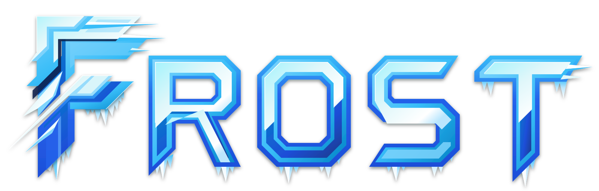

  

# Frost ❄️

A modular, declarative NixOS starter framework and external Flake distribution.

Frost separates reusable operating system primitives, Wayland desktop infrastructure, and developer toolchains from private host identities. It supplies **110+ granular, toggleable modules** covering system daemons, display managers, impermanence storage engines, containerized services, and user environments.

---

## Why "Frost"? (The Lore)

> **frost** (`/frɔːst/`) — *noun:* The crystalline deposit of delicate ice needles that binds cold surfaces together, transforming raw terrain into a unified, resilient winter landscape.

In polar environments, frost is not static freezing. It is the crystalline glaze that seals porous rock, anchors shifting gravel into firm bedrock, and wraps entire mountain ranges in a cohesive protective armor.

**Frost provides the foundational glaze of the ecosystem:**
- **Bedrock Glaze**: A hermetic NixOS foundation that binds system daemons, desktop compositors, and development toolchains into a reproducible whole.
- **Granular Crystallization**: Over 110 toggleable modules that crystallize only when explicitly enabled, leaving zero runtime overhead or orphan packages behind.

---

## Core Tenets

- **Zero Burnt-in Identity**: Modules are strictly parameterized. No private credentials, hardcoded usernames, or local machine paths exist in upstream declarations.
- **Dual Consumption Model**: Deploy directly as a standalone starter template (fork and customize) or consume Frost as an external Flake input in a private fleet repository.
- **Ephemeral Impermanence**: Native Disko partitioning with Btrfs rollback subvolumes or tmpfs-on-root setups to ensure deterministic system boots.
- **Out-of-Store Symlinking**: Dotfile hot-reloading via parameterized out-of-store symlinks, enabling instant edits in user configs without rebuild cycles.
- **Declarative Operations**: Automated installation (`frost-install`) and rescue mounting (`frost-recover`) available as Flake apps.

---

## Table of Contents

- [Getting Started](getting-started.md)
  - [Prerequisites](getting-started.md#prerequisites)
  - [Adoption: Starter Template vs Flake Library](getting-started.md#adoption-models)
  - [Workstation Profile](getting-started.md#workstation-profile)
  - [Headless Server Profile](getting-started.md#server-profile)
- [System Architecture](architecture.md)
  - [Flake & Fleet Separation](architecture.md#flake--fleet-separation)
  - [Repository Layout](architecture.md#directory-hierarchy)
  - [Storage Model & Impermanence](architecture.md#ephemeral-storage--disko-partitioning)
  - [Out-of-Store Symlinks](architecture.md#out-of-store-symlinking)
- [Module Reference](modules.md)
  - [System Options (`frost.*`)](modules.md#system-modules-frost)
  - [User Options (`frost.home.*`)](modules.md#user-modules-frosthome)
- [CLI & Workflows](usage.md)
  - [Automated Deployment (`frost-install`)](usage.md#frost-install)
  - [Disaster Recovery (`frost-recover`)](usage.md#frost-recover)
  - [Dotfile Hot-Reloading](usage.md#dotfiles-hot-reloading)
  - [Encrypted Secrets with SOPS](usage.md#sops-secrets-workflow)
