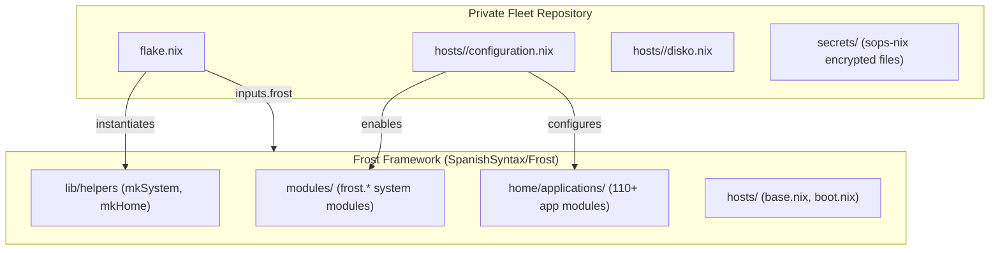
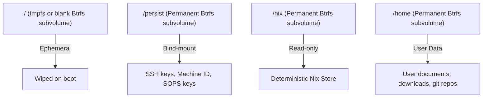

# Architecture & Foundations

Frost implements a modular architecture designed to decouple system and user environment definitions from hardware bindings and identity credentials.

---

## Why "Frost"? (The Lore)

> **frost** (`/frɔːst/`) — *noun:* The crystalline deposit of delicate ice needles that binds cold surfaces together, transforming raw terrain into a unified, resilient winter landscape.

In polar extremes, frost is not inert freezing—it is the crystalline glaze that seals porous stone, locks shifting gravel into permanent bedrock, and coats entire mountain ranges in a cohesive protective armor.

**Frost serves as the foundational glaze of the ecosystem:**
- **Bedrock Glaze**: A declarative, hermetic NixOS foundation that binds system services, desktop environments, and developer toolchains into a resilient whole.
- **Granular Crystallization**: Over 110 toggleable modules that crystallize only when enabled, leaving zero unneeded weight or runtime bloat behind.

---

## Flake & Fleet Separation

A core principle in Frost is separating reusable framework logic from fleet deployments:



1. **Upstream (Frost)**: Contains parameter-driven modules, application wrappers, out-of-store symlink logic, and base NixOS defaults.
2. **Downstream (Fleet)**: Contains hardware configurations, disk partitioning targets, user definitions, and SOPS-encrypted credentials.

---

## Directory Hierarchy

The repository is structured into distinct, non-overlapping domains:

```text
Frost/
├── flake.nix               # Flake inputs, library exports, and starter configurations
├── installer/              # Deployment & rescue tooling (frost-install, frost-recover)
│   ├── default.nix         # Derivations for installer tools
│   ├── install.sh          # Automated Disko partitioning & deployment script
│   └── recover.sh          # Auto-mounting rescue tool for Btrfs impermanence
├── lib/
│   └── helpers/            # Reusable builders (mkSystem, mkHome, recursive file scraper)
├── hosts/                  # Starter host configurations and base profiles
│   ├── base.nix            # Core Nix settings (GC, flakes, trusted-users)
│   ├── boot.nix            # standard systemd-boot loader configuration
│   ├── workstation/        # Starter graphical workstation profile
│   └── server/             # Starter headless server profile
├── modules/                # System-level 2-level modules (frost.* namespace)
│   ├── system/             # Boot, locale, runtime (home_manager, fhs), storage (impermanence, zfs)
│   ├── hardware/           # PipeWire audio, peripherals (Bluetooth, printing), power, sensors (IIO)
│   ├── network/            # Stack, edge (Caddy, AdGuard), remote (SSH, WayVNC), sync, VPNs
│   ├── security/           # Auth (PAM, Polkit, YubiKey) & secrets (SOPS, 1Password, keyring)
│   ├── desktop/            # 8 DMs, 8 DEs, 8 WMs, and session-scoped XDG portals
│   ├── virtualization/     # Containers (Docker, Podman, OCI), VMs (MicroVM, Libvirt), stacks
│   └── programs/           # Flatpak, gaming (Steam), system utilities
├── configs/                # Starter dotfiles & system configs
│   ├── home/               # Starter user configs (caelestia, nvim, sled, zsh.d, antigravity)
│   └── system/             # Starter system configs (caddy)
└── home/                   # User-level Home Manager modules (frost.home.* namespace)
    ├── home.nix            # Central user module collector
    ├── applications/       # 110+ XDG-categorized app modules (ai, dev, graphics, media, office, ...)
    ├── desktop/            # Wayland shells (igloo) & desktop tools (borealis, shards, igloo_cli)
    ├── environment/        # configsPath / mkSource, fonts, GTK, XDG, global ignores
    ├── services/           # User services (syncthing, google_drive)
    └── users/              # User profiles
        └── frost.nix       # Generic starter user environment
```

---

## Ephemeral Storage & Disko Partitioning

Frost treats root filesystems as ephemeral state. By leveraging [Disko](https://github.com/nix-community/disko) and Btrfs snapshots (or tmpfs-on-root via Impermanence), the root subvolume is wiped on every boot:



### Subvolume Layout

In `hosts/workstation/disko.nix`, the storage layout is partitioned into:

- `@` — Ephemeral root, snapshotted or reset on boot.
- `@nix` — Persistent Nix store.
- `@persist` — Critical system state (`/etc/machine-id`, `/etc/ssh`, `/etc/sops`).
- `@home` — Persistent user home directories.
- `@boot` — ESP partition for systemd-boot.

---

## Out-of-Store Symlinking & Tapes v2

Iterating on Wayland configurations or desktop dotfiles traditionally requires a `nixos-rebuild switch`. Frost provides centralized path resolution via `frost.home.environment.configsPath` and `mkSource`:

```nix
frost.home.environment = {
  # String path -> mutable out-of-store symlinks (live hot-reloading)
  configsPath = "${config.home.homeDirectory}/Glacier/configs/home";

  # Nix path literal -> immutable in-store copy (pure server builds)
  # configsPath = ../configs/home;
  # mutable = false;
};
```

- When `configsPath` is a string and `mutable = true`, `mkSource` delegates to `config.lib.file.mkOutOfStoreSymlink`, so edits take effect immediately on save without invoking `nixos-rebuild`.
- When `configsPath` is `null`, Frost falls back to its built-in starter templates in `configs/home/`.
- For desktop/WM rices (`hypr/`, `caelestia/`, `waybar/`, etc.), Frost also packages **Tapes v2** (`frost.home.apps.settings.desktop.tapes.enable = true`), allowing users to pull and atomically swap additional `~/.config` rices without disturbing Home Manager-owned tool configs (`sled/`, `nvim/`, `zsh.d/`).
