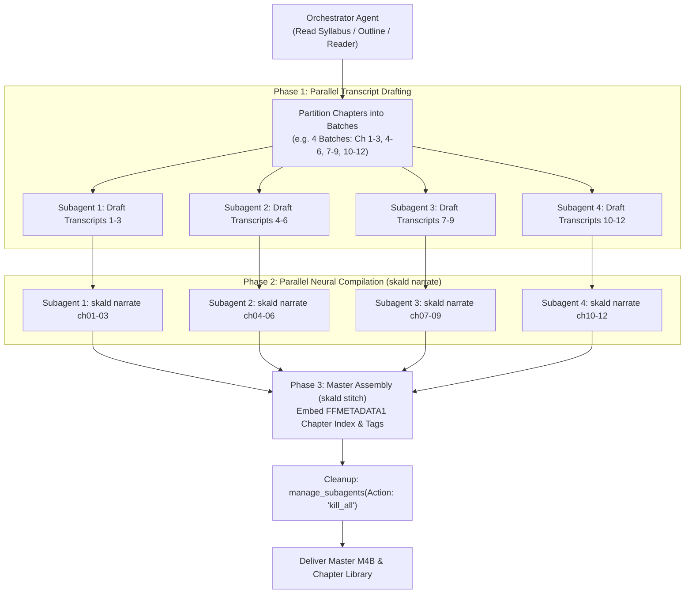

# Deep Audiobook (Conversational Lecture Companion & M4B Audiobook Compiler)

## Summary
Synthesizes written markdown documents, textbook chapters, lecture notes, and study guides into broadcast-grade, chapter-indexed M4B audiobooks and standalone MP3 companions. Engineered for deep auditory comprehension: instead of reading literal algebra or dry raw symbols, it translates abstract concepts into intuitive physical mechanics, engineering trade-offs, and multi-voice conversational dialogues. Powered by **Skald**, sentence-chunked Microsoft Edge-TTS neural speech, multi-speaker turn parsing, and FFmpeg MPEG-4 chapter muxing.

## When to Use
- The user requests an audiobook companion, spoken audio series, podcast breakdown, or conversational lecture walkthrough for any document or course.
- The user provides single or multi-chapter Markdown documents and needs publication-grade `.m4b` audiobooks with embedded QuickTime chapter scrub bars.
- The user asks to narrate scripts with multiple voice actors (e.g., narrator, professor, student, interviewer).

## Operational Contract (🎙️ Spoken Pedagogical Standard)
- **Parallel Swarm Execution in Chapter Mode**: When synthesizing multi-chapter audiobooks (3+ chapters), **always parallelize across subagents**. Never generate chapters sequentially in a single context. Spawn a swarm of subagents to draft transcripts and compile audio in parallel, then stitch into a unified master companion.
- **Spoken Mechanics Over Formula Recitation**: Never recite raw algebra character-by-character (avoid *"x transpose capital H x plus c transpose x"*). Instead, speak the intuitive mechanics: *"a bowl-shaped valley curved by the Hessian matrix, tilted down the slope of the linear gradient vector"*.
- **Sentence-Level Chunking**: Never send text payloads larger than 2,500 characters to Azure Neural TTS. Strict chunking at sentence boundaries prevents WebSocket aborts and `NoAudioReceived` drops.
- **True QuickTime / M4B Chapter Markers**: Always deliver `.m4b` files with embedded `FFMETADATA1` structures for full scrub bar navigation in Apple Books, Audible, VLC, and mobile players.
- **Dual Format Deliverables**: Export both standalone chapter `.m4b` / `.mp3` files and a unified master audiobook (`Master_Audiobook.m4b`).
- **Resilient Retry Loop**: Relies on built-in exponential backoff (up to 5 retries), rate limit detection (429 handling), and timeout watchdogs against cloud TTS drops.

---

## ⚡ Parallel Swarm Architecture (Chapter Mode & Multi-Agent Orchestration)

Multi-chapter audiobooks require high I/O and cloud neural synthesis time. To generate an entire textbook or course companion in minutes rather than hours, the orchestrator agent must execute the following 3-stage swarm pipeline:



### Swarm Execution Protocol:

1. **Partitioning**:
   - Divide $N$ chapters into chunks of 2–3 chapters per subagent.
   - Example prompt for transcript drafting:
     ```python
     invoke_subagent(
         TypeName="self",
         Role="Audiobook Writer (Ch 01-03)",
         Prompt="Draft conversational spoken transcripts for Chapters 1 through 3 in AI/audio/transcripts/ using intuitive physical mechanics instead of raw algebra."
     )
     ```

2. **Parallel Neural Synthesis**:
   - Have subagents run `skald narrate` concurrently on their assigned files:
     ```bash
     skald narrate transcripts/ch01.md -o audio/
     ```

3. **Master Muxing**:
   - Once all subagents finish, the orchestrator runs `skald stitch`:
     ```bash
     skald stitch ./audio/ --output ./audio/Master_Companion.m4b --mp3
     ```

4. **Reaping Mandate**:
   - Subagents remain registered in an `idle` state in Antigravity. The orchestrator **must** call `manage_subagents(Action: "kill_all")` immediately after stitching to free background session resources.

---

## Document Ordering & Discovery Protocol

Skald resolves chapter sequences and book metadata through a flexible **4-Tier Ordering Protocol**:

### Tier 1: Explicit Manifest File (`audiobook.yaml`, `book.toml`, `skald.yaml`)
When authoring a modular book or course series, declare ordering and metadata in a manifest file:

```yaml
# audiobook.yaml (or book.yaml)
title: "Distributed Systems & Consensus"
author: "Engineering Architecture Group"
album: "Systems Audio Library"
voice: "en-US-GuyNeural"
chapters:
  - path: "chapters/01_introduction.md"
    title: "Chapter 1: Network Synchrony & Failures"
  - path: "chapters/02_consensus_paxos.md"
    title: "Chapter 2: The Paxos Protocol"
  - path: "chapters/03_raft_replicated_state.md"
    title: "Chapter 3: Raft Consensus in Practice"
```

Or in TOML (`audiobook.toml` / `book.toml`):
```toml
title = "Distributed Systems & Consensus"
author = "Engineering Architecture Group"
chapters = [
  "chapters/01_introduction.md",
  "chapters/02_consensus_paxos.md",
  "chapters/03_raft_replicated_state.md",
]
```

### Tier 2: Master Document Frontmatter (`index.md` or `master.md`)
Declare ordered chapters inside the root document's frontmatter:
```markdown
---
title: "Signal Processing Fundamentals"
author: "Signals Group"
chapters:
  - ch01_fourier.md
  - ch02_z_transform.md
  - ch03_filter_design.md
---
```

### Tier 3: Directory Order Manifest (`order.txt`)
A simple newline-separated list of filenames inside the chapter directory:
```text
01_preface.md
02_core_theorems.md
03_case_studies.md
```

### Tier 4: Natural Alphanumeric Sort (Zero-Config)
If no manifest is declared, Skald scans the directory and sorts filenames using natural numerical ordering (`ch01`, `ch02`, `ch10`), preventing lexicographical ordering bugs (`1, 10, 2`).

---

## Authoring Transcripts for Multi-Voice Speech

Transcripts support frontmatter metadata and multi-voice dialogue annotations:

```markdown
---
title: "State Estimation and Kalman Filtering"
author: "Robotics Laboratory"
album: "Autonomous Systems Companion"
voice: "en-US-GuyNeural"
speaker_narrator: "en-US-GuyNeural"
speaker_professor: "en-US-ChristopherNeural"
speaker_student: "en-US-AriaNeural"
---

# 1. The Observation Dilemma

Sensors are noisy windows into an uncertain physical world.

**Professor:** When your accelerometer drifts and your wheel encoders slip, neither sensor alone knows the truth.

**Student:** How do we fuse conflicting measurements without blowing up uncertainty?

**Professor:** That is the core insight of Kalman filtering: we weight each sensor by its inverse covariance, allowing precision to dominate error.
```

---

## Toolchain & Compilation Pipeline

### Step 1: Voice Discovery (`skald voices`)
List and filter available neural voices:
```bash
# Discover voices for a specific locale
skald voices --locale en-US --gender Male
skald voices --locale nl-NL
```

### Step 2: Synthesize Transcripts (`skald narrate`)
Compile individual chapter transcripts into standalone `.m4b` and `.mp3` files:
```bash
# Narrate a single transcript
skald narrate transcripts/01_intro.md --voice en-US-GuyNeural -o ./dist/

# Machine JSON output for agents
skald narrate transcripts/01_intro.md --json
```

### Step 3: Stitch Master Audiobook (`skald stitch`)
Merge standalone chapters into a unified master companion with navigable chapter markers:
```bash
# Point directly to a directory or manifest
skald stitch ./audio/ \
  --output ./audio/Master_Companion.m4b \
  --title "Course Audio Companion" \
  --author "Department of Systems and Control" \
  --cover ./cover.png \
  --mp3
```

### Step 4: Inspect Audiobook Markers (`skald inspect`)
Inspect embedded chapter points, bitrates, and durations:
```bash
skald inspect ./audio/Master_Companion.m4b
```
