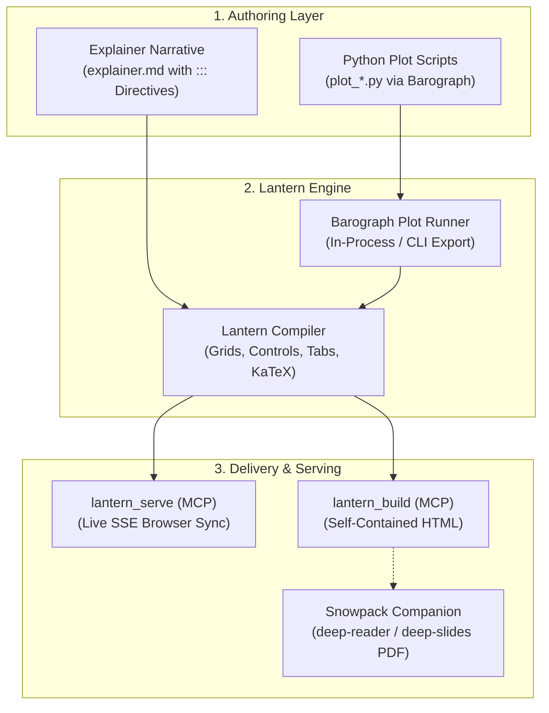

# Deep Interactive (Interactive Explainer & Simulation Dashboard Engine)

## Summary
Generates interactive, production-grade algorithmic explainer sites, live simulation dashboards, and Antigravity Artifacts powered by **Lantern** as the interactive web counterpart to **Snowpack**, with numerical simulation plots executed and extracted via **Barograph**. Binds high-level physical intuition, rich KaTeX mathematics, and Mermaid diagrams with spatial multi-column layout strips (`50/50`, `60/40`), live parameter sliders, tabs, accordions, and Plotly visualizations.

## When to Use
- The user asks for an "interactive explainer", "visual deep-dive", "simulation dashboard", "interactive HTML demonstration", or "live parameter lab".
- An algorithm, dynamical system, or optimization scheme requires dynamic parameter exploration (e.g., interactive convergence walkers, penalty/barrier sliders, phase portrait zooming, live state metrics).
- The user wants a companion interactive web dashboard alongside static Snowpack PDFs (`deep-reader` / `deep-slides`).

## Operational Contract (🏛️ Deep / Production Compiler)
- **Web Counterpart to Snowpack**: Where `Snowpack` compiles static, publication-grade PDFs (Typst/LaTeX), `Lantern` compiles and serves dynamic, interactive web explainers (DOM, HTML5 Canvas, live parameter sliders, KaTeX math, Plotly embeds).
- **Barograph Separation of Concerns**: Python simulation scripts (`plot_*.py`) are executed and extracted via `Barograph`, while `Lantern` handles the Markdown narrative, live-reloading dev server, spatial layout grids, interactive widgets, and standalone HTML bundle compilation.
- **Sled MCP First-Class Support**:
  - `lantern_serve(path, port, no_open)`: Spawns the local HTTP server with automatic port discovery, watches Markdown and Python files, and pushes instant browser updates over SSE.
  - `lantern_build(path, out_dir, standalone)`: Compiles a zero-dependency, single `.html` file ready for sharing, hosting, or embedding in Antigravity Artifacts.
  - `lantern_new(name, template)`: Scaffolds a new explainer or dashboard workspace.

---

## Toolchain & Execution Pipeline



### Step 1: Write Standalone Python Plot Scripts (`plot_*.py`)
Write focused, self-contained Python plotting scripts adhering to Barograph protocols:
- Use standard **Plotly** (`fig = go.Figure()`) or **Matplotlib/Seaborn**.
- **Do NOT call `fig.show()` or `plt.show()`**; Barograph automatically discovers and extracts `fig`.
- Example (`plot_trajectory.py`):
  ```python
  import numpy as np
  import plotly.graph_objects as go
  from scipy.integrate import solve_ivp

  def dynamics(t, state):
      x, v = state
      return [v, -0.3 * v - np.sin(x)]

  t_eval = np.linspace(0, 20, 1000)
  sol = solve_ivp(dynamics, (0, 20), [2.5, 0.0], t_eval=t_eval)

  fig = go.Figure()
  fig.add_trace(go.Scatter(x=sol.t, y=sol.y[0], mode="lines", name="Angle θ(t)"))
  fig.add_trace(go.Scatter(x=sol.t, y=sol.y[1], mode="lines", name="Velocity ω(t)"))
  fig.update_layout(
      title="Nonlinear Pendulum Dynamics",
      xaxis_title="Time (s)",
      yaxis_title="State Amplitude",
      margin=dict(l=40, r=40, t=50, b=40),
  )
  ```

---

### Step 2: Compose Narrative & Interactive Directives (`explainer.md`)

`Lantern` provides a complete, two-tier design system right inside Markdown:

#### 📐 Family 1: Layout Strips & Spatial Chrome
1. **`::: grid [50/50 | 60/40 | 40/60 | 3-col | 4-col]`**:
   Creates responsive side-by-side rows. Automatically collapses on mobile.
   ```markdown
   ::: grid 60/40
   === Left
   ::: plot plot_trajectory.py height=500px
   :::

   === Right
   ### Parameter Exploration
   ::: slider id="damping" label="Damping Coefficient γ" min=0.0 max=2.0 step=0.1 default=0.3
   :::
   ::: metrics
   - Settling Time: 4.2 s
   - Peak Overshoot: 18.4 %
   - State: Stable
   :::
   :::
   ```
2. **`::: card [title="..."] [badge="..."] [icon="..."]`**:
   Glassmorphic bordered boxes inside any column or document flow.
3. **`::: stepper id="..."`**:
   Step-by-step phase indicators for multi-stage algorithms (e.g., Step 1 $\to$ Step 2 $\to$ Step 3).
4. **`::: curtain`**:
   Draggable split-slider revealing before/after or comparison states.

#### 🎛️ Family 2: Interactive Controls & Lab Inputs
1. **`::: slider id="..." label="..." min=... max=... step=... default=... [unit="..."]`**:
   Parameter slider with a live numeric readout badge updating synchronously on drag.
2. **`::: switch id="..." label="..." [default=true|false]`**:
   Smooth iOS-style boolean toggle switch.
3. **`::: segments id="..." default="..."`**:
   Mutually exclusive tactile pill button selector group.
4. **`::: player target="..."`**:
   Simulation media bar (`[ ⏮ Reset ] [ ⏯ Play/Pause ] [ ⏭ Step ]`, speed multipliers).

#### ⚡ Family 3: Editorial Content, Feedback & Micro-Interactions
1. **`::: plot <script.py> [backend=plotly|svg] [height=500px]`**:
   Executes via `Barograph` and embeds the figure with a full-screen lightbox expander button.
2. **`::: tabs`**:
   Multi-perspective tabbed view switcher (e.g. `=== Intuition`, `=== Derivation`, `=== Simulation`).
3. **`::: accordion title="..." [open]`**:
   Smooth collapsible deep-dive cards for proofs, derivations, and appendices.
4. **`::: metrics`**:
   KPI stat cards with bold figures and status badges.
5. **`::: comparison`**:
   Two-column side-by-side trade-off cards (Method A vs. Method B).
6. **`::: callout type=[note|tip|warning|danger]`**:
   Alert banners.

---

### Step 3: Launch Live Preview or Build Standalone HTML

* **Live Serving with Hot-Reload**:
  Use Sled MCP tool:
  `lantern_serve(path="explainer.md", no_open=True)`
  Or CLI:
  ```bash
  lantern serve explainer.md
  ```
  Spawns the local HTTP server with automatic port discovery, watches Markdown and Python files, and pushes instant browser updates over SSE.

* **Production Standalone Compilation**:
  Use Sled MCP tool:
  `lantern_build(path="explainer.md", out_dir="dist", standalone=True)`
  Or CLI:
  ```bash
  lantern build explainer.md -o dist/ --standalone
  ```
  Compiles a zero-dependency, single `.html` file ready for sharing, hosting, or embedding in Antigravity Artifacts.

* **Production Bundle & Server Export**:
  Export deployable static bundles or standalone Python Jinja2 projects:
  ```bash
  lantern export explainer.md --format static   # Deployable static bundle for Caddy / Nginx / Cloudflare
  lantern export explainer.md --format jinja    # Standalone Jinja2 WSGI project (app.py, templates, Dockerfile)
  ```

* **Agent & Tool Automation Mode**:
  Pass `--agent` (`-A`) or `--json` to suppress ANSI boxes and emit compact, structured JSON payloads:
  ```bash
  lantern status --json
  lantern build explainer.md --json
  lantern export explainer.md --json
  ```

---

### Step 4: Companion Static Deliverables via Snowpack
In the document frontmatter of `explainer.md`, declare:
```yaml
---
title: Marine Pollutant Dispersion
author: DCSC TU Delft
snowpack_pdf: report.pdf
---
```
Lantern will automatically render a prominent hero header button linking to the companion PDF reader compiled by Snowpack!
* Formal syllabus textbook chapter: [`deep-reader`](file:///home/usurper/Frost/home/configs/antigravity/skills/deep-reader/SKILL.md) (`snowpack report.md -m report`)
* 16:9 keynote presentation deck: [`deep-slides`](file:///home/usurper/Frost/home/configs/antigravity/skills/deep-slides/SKILL.md) (`snowpack slides.md -m slides`)
