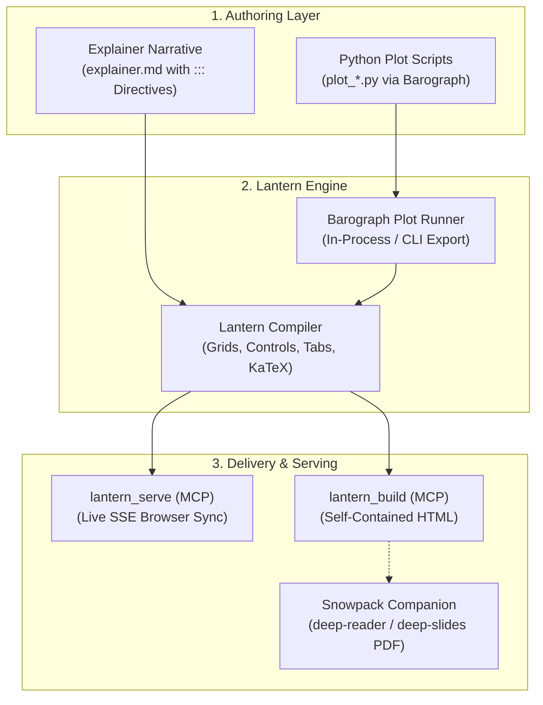

# Deep Interactive (Interactive Explainer & Simulation Dashboard Engine)

## Summary
Generates interactive, production-grade algorithmic explainer sites, live simulation dashboards, and Antigravity Artifacts powered by **Lantern** as the interactive web counterpart to **Snowpack**, with numerical simulation plots executed and extracted via **Barograph**. Binds high-level physical intuition, rich KaTeX mathematics, and Mermaid diagrams with spatial multi-column layout strips (`50/50`, `60/40`), live parameter sliders, tabs, accordions, and Plotly visualizations.

## When to Use
- The user asks for an "interactive explainer", "visual deep-dive", "simulation dashboard", "interactive HTML demonstration", or "live parameter lab".
- An algorithm, dynamical system, or optimization scheme requires dynamic parameter exploration (e.g., interactive convergence walkers, penalty/barrier sliders, phase portrait zooming, live state metrics).
- The user wants a companion interactive web dashboard alongside static Snowpack PDFs (`deep-reader` / `deep-slides`).

## Operational Contract (🏛️ Deep / Production Compiler)
- **Web Counterpart to Snowpack**: Where `Snowpack` compiles static, publication-grade PDFs (Typst/LaTeX), `Lantern` compiles and serves dynamic, interactive web explainers (DOM, HTML5 Canvas, live parameter sliders, KaTeX math, Plotly embeds).
- **Barograph Separation of Concerns**: Python simulation scripts (`plot_*.py`) are executed and extracted via `Barograph`, while `Lantern` handles the Markdown narrative, live-reloading dev server, spatial layout grids, interactive widgets, and standalone HTML bundle compilation.
- **Sled MCP First-Class Support**:
  - `lantern_serve(path, port, no_open)`: Spawns the local HTTP server with automatic port discovery, watches Markdown and Python files, and pushes instant browser updates over SSE.
  - `lantern_build(path, out_dir, standalone)`: Compiles a zero-dependency, single `.html` file ready for sharing, hosting, or embedding in Antigravity Artifacts.
  - `lantern_new(name, template)`: Scaffolds a new explainer or dashboard workspace.

---

## Toolchain & Execution Pipeline



### Step 1: Write Standalone Python Plot Scripts (`plot_*.py`)
Write focused, self-contained Python plotting scripts adhering to Barograph protocols:
- Use standard **Plotly** (`fig = go.Figure()`) or **Matplotlib/Seaborn**.
- **Do NOT call `fig.show()` or `plt.show()`**; Barograph automatically discovers and extracts `fig`.
- Example (`plot_trajectory.py`):
  ```python
  import numpy as np
  import plotly.graph_objects as go
  from scipy.integrate import solve_ivp

  def dynamics(t, state):
      x, v = state
      return [v, -0.3 * v - np.sin(x)]

  t_eval = np.linspace(0, 20, 1000)
  sol = solve_ivp(dynamics, (0, 20), [2.5, 0.0], t_eval=t_eval)

  fig = go.Figure()
  fig.add_trace(go.Scatter(x=sol.t, y=sol.y[0], mode="lines", name="Angle θ(t)"))
  fig.add_trace(go.Scatter(x=sol.t, y=sol.y[1], mode="lines", name="Velocity ω(t)"))
  fig.update_layout(
      title="Nonlinear Pendulum Dynamics",
      xaxis_title="Time (s)",
      yaxis_title="State Amplitude",
      margin=dict(l=40, r=40, t=50, b=40),
  )
  ```

---

### Step 2: Compose Narrative & Interactive Directives (`explainer.md`)

`Lantern` provides a complete, production-grade component ecosystem right inside Markdown. All components have built-in styling, zero runtime dependencies, and work offline.

#### 📄 Document Frontmatter
```yaml
---
title: "Document Title"
subtitle: "Analytical Subtitle or Abstract"
author: "Research Group / Author"
date: "2026-10-29"                # Optional (omitted if not declared)
badge: "Interactive Lab"          # Optional hero badge
footer: "Custom footer text"      # Optional footer override
nav_dots: true                    # Set false to disable vertical dot rail
snowpack_pdf: "report.pdf"        # Optional link to companion PDF reader
template: explainer               # 'explainer' (default) or 'dashboard'
---
```

#### 📐 Family 1: Layout Strips & Spatial Chrome
1. **`::: grid [50/50 | 60/40 | 40/60 | 3-col | 33/33/33 | 4-col]`**:
   Creates responsive multi-column layouts with equal-height baseline enforcement:
   ```markdown
   ::: grid 60/40
   === Simulation View
   ::: plot plot_trajectory.py height=480px title="Phase Orbit"
   :::

   === Controls
   ::: card title="Parameters" icon="🎛️"
   ::: slider id="gamma" label="Damping" min=0.0 max=2.0 step=0.1 default=0.3 unit=""
   :::
   :::
   :::
   ```

2. **`::: card [title="..."] [badge="..."] [icon="..."]`**:
   Glassmorphic elevated card with optional header icon, title, and status badge:
   ```markdown
   ::: card title="Boundary Mechanics" badge="Active" icon="📐"
   Card content, equations ($x^2$), and control atoms.
   :::
   ```

3. **`::: stepper id="..."`**:
   Zero-jerk progressive phase walkthrough using CSS Grid stacking:
   ```markdown
   ::: stepper id="solver-stepper"
   === Step 1: Formulation
   Formulate continuous operator $-\Delta u = \lambda u$.

   === Step 2: Discretization
   Discretize on mesh $h = \Delta x$.

   === Step 3: Spectral Solve
   Solve generalized eigenvalue matrix system $K \mathbf{u} = \lambda M \mathbf{u}$.
   :::
   ```

4. **`::: curtain [before="Before"] [after="After"]`**:
   Side-by-side or before/after comparison split cards:
   ```markdown
   ::: curtain before="Initial Mesh" after="Refined Mesh"
   Content or plots for initial state.
   ===
   Content or plots for refined state.
   :::
   ```

#### 🎛️ Family 2: Interactive Controls & Lab Inputs
All controls emit standard DOM custom events (`lantern:input` with `{ id, value }`) and update live badge readouts without page reloads.

1. **`::: slider id="..." label="..." min=... max=... step=... default=... [unit="..."]`**:
   ```markdown
   ::: slider id="alpha" label="Step Size α" min="0.001" max="0.1" step="0.005" default="0.01" unit="s"
   :::
   ```

2. **`::: switch id="..." label="..." [default=true|false]`**:
   ```markdown
   ::: switch id="damping" label="Enable Damping Regularization" default=true
   :::
   ```

3. **`::: segments id="..." default="..."`**:
   Mutually exclusive tactile pill button selector group:
   ```markdown
   ::: segments id="mode-selector" default="fine"
   - [coarse]: Coarse Mesh (30×30)
   - [fine]: Fine Mesh (60×60)
   - [ultra]: Ultra Resolution (120×120)
   :::
   ```

4. **`::: select id="..." label="..." [default="..."]`**:
   Native dropdown selector with themed obsidian skin:
   ```markdown
   ::: select id="colormap" label="Colormap Palette"
   - [jet]: Jet (MATLAB Retro)
   - [viridis]: Viridis
   - [magma]: Magma
   - [ice]: Obsidian Frost
   :::
   ```

5. **`::: player id="..." target="..." speeds="0.5x, 1x, 2x, 5x"`**:
   Simulation transport media scrub bar (`[⏮ Reset] [⏯ Play/Pause] [⏭ Step]`):
   ```markdown
   ::: player id="sim-player" target="phase-space" speeds="0.5x, 1x, 2x, 5x"
   :::
   ```

#### ⚡ Family 3: Editorial Content, Feedback & Micro-Interactions
1. **`::: plot <script.py> [backend=plotly|svg] [height=500px] [title="..."]`**:
   Runs script in-process via Barograph and embeds the interactive plot with fullscreen lightbox.
   - **Automatic Reactive Frame Sync**: If `plot.py` defines Plotly `frames` named with parameter numbers (e.g. `f"{w:.2f}"`) or `f"{id}:{val}"`, moving any Markdown `::: slider id="..."` automatically scrubs Plotly frames at 60 FPS without camera jump!
   - **Camera & Zoom Lock**: Automatically injects `uirevision` so 3D orbital camera orientation and 2D pan/zoom ranges stay locked when frames change.
   ```markdown
   ::: plot plot_membrane.py backend=plotly height=480px title="Fundamental Eigenmode"
   :::
   ```

2. **`::: math-plot fn="..." [domain="0, 10"] [height=360px] [title="..."]`**:
   Instant client-side 60 FPS mathematical formula evaluator. Evaluates `fn` across `domain` using live slider variables (`omega`, `gamma`, `alpha`, `beta`, `k`, `A`):
   ```markdown
   ::: slider id="omega" label="Frequency" min=1 max=15 default=4
   :::
   ::: math-plot fn="Math.exp(-gamma * x) * Math.cos(omega * x)" domain="0, 10" height=380px title="Damped Wave"
   :::
   ```

3. **`::: widget [id="..."] [height=360px] [title="..."]`**:
   Composable Generative Sandbox for custom physics, canvas animations, and interactive models. Provides High-DPI auto-resizing canvas, `ctx`, `theme`, and live parameter lookup via `window.lantern.get(id, default)`:
   ```markdown
   ::: widget id="cart-pendulum" height=320px title="Inverted Pendulum Lab"
   let theta = 0.2;
   function loop() {
     const damping = window.lantern.get('gamma', 0.2);
     // Draw to ctx using theme.cyan, theme.purple...
     requestAnimationFrame(loop);
   }
   requestAnimationFrame(loop);
   :::
   ```

4. **`::: tabs`**:
   Multi-perspective tabbed switcher:
   ```markdown
   ::: tabs
   === Theory & Derivation
   Mathematical formulation with KaTeX display math:
   $$\min_{x} f(x) \quad \text{subject to} \quad g(x) \le 0$$

   === Discrete Implementation
   ```python
   def solve_eigenvalues(K, M):
       return scipy.linalg.eigh(K, M)
   ```
   :::

3. **`::: accordion title="..." [open=true|false]`**:
   Collapsible deep-dive cards for proofs, derivations, and appendices:
   ```markdown
   ::: accordion title="Proof of Quadratic Convergence for Newton-Raphson"
   Let $e_k = x_k - x^*$. By Taylor expansion:
   $$\|e_{k+1}\| \le \frac{L}{2 \mu} \|e_k\|^2$$
   :::
   ```

4. **`::: metrics [cols=2|3|4]`**:
   KPI status row with color badges (`emerald`, `cyan`, `purple`, `amber`, `rose`):
   ```markdown
   ::: metrics cols=4
   - Iterations: 42
   - Residual: 1.2e-7 [badge=emerald]
   - Condition Number: 18.4 [badge=cyan]
   - Convergence: Verified [badge=purple]
   :::
   ```

5. **`::: comparison`**:
   Two-column comparative trade-off card (Method A vs. Method B):
   ```markdown
   ::: comparison
   === Left: First-Order Gradient Descent
   - Memory complexity $O(n)$
   - Linear convergence rate $O(1/k)$

   === Right: Second-Order Newton-Raphson
   - Memory complexity $O(n^2)$
   - Quadratic local convergence
   :::
   ```

6. **`::: callout type=[note|tip|warning|danger] [title="..."]`**:
   Callout alert banner:
   ```markdown
   ::: callout type=tip title="Mesh Refinement"
   Corner singularities require graded geometric bisection near the reentrant vertex.
   :::
   ```

7. **`[?term: hint]` Inline Tooltips**:
   Contextual hover tooltips for specialized nomenclature:
   ```markdown
   Near the [?reentrant corner: An interior corner angle greater than 180 degrees that induces singular stress fields], stress approaches infinity.
   ```

8. **Automated Floating Section Dot Rail**:
   Lantern automatically generates an active ScrollSpy vertical dot rail on the right margin from all `## Section` headings when 2 or more sections exist. Hovering any dot shows the section title, and clicking smoothly scrolls to that anchor. Toggle off with `nav_dots: false` in frontmatter if not desired.

---

### Step 3: Launch Live Preview or Build Standalone HTML

* **Live Serving with Hot-Reload**:
  Use Sled MCP tool:
  `lantern_serve(path="explainer.md", no_open=True)`
  Or CLI:
  ```bash
  lantern serve explainer.md
  ```
  Spawns the local HTTP server with automatic port discovery, watches Markdown and Python files, and pushes instant browser updates over SSE.

* **Production Standalone Compilation**:
  Use Sled MCP tool:
  `lantern_build(path="explainer.md", out_dir="dist", standalone=True)`
  Or CLI:
  ```bash
  lantern build explainer.md -o dist/ --standalone
  ```
  Compiles a zero-dependency, single `.html` file ready for sharing, hosting, or embedding in Antigravity Artifacts.

* **Production Bundle & Server Export**:
  Export deployable static bundles or standalone Python Jinja2 projects:
  ```bash
  lantern export explainer.md --format static   # Deployable static bundle for Caddy / Nginx / Cloudflare
  lantern export explainer.md --format jinja    # Standalone Jinja2 WSGI project (app.py, templates, Dockerfile)
  ```

* **Agent & Tool Automation Mode**:
  Pass `--agent` (`-A`) or `--json` to suppress ANSI boxes and emit compact, structured JSON payloads:
  ```bash
  lantern status --json
  lantern build explainer.md --json
  lantern export explainer.md --json
  ```

---

### Step 4: Companion Static Deliverables via Snowpack
In the document frontmatter of `explainer.md`, declare:
```yaml
---
title: Marine Pollutant Dispersion
author: DCSC TU Delft
snowpack_pdf: report.pdf
---
```
Lantern will automatically render a prominent hero header button linking to the companion PDF reader compiled by Snowpack!
* Formal syllabus textbook chapter: [`deep-reader`](file:///home/usurper/Frost/home/configs/antigravity/skills/deep-reader/SKILL.md) (`snowpack report.md -m report`)
* 16:9 keynote presentation deck: [`deep-slides`](file:///home/usurper/Frost/home/configs/antigravity/skills/deep-slides/SKILL.md) (`snowpack slides.md -m slides`)

---

### Step 5: Multi-Page Scientific Portals & Course Hubs

When authoring a comprehensive technical portal (e.g. university courses, multi-chapter textbook sites, or multi-algorithm suites with dedicated quiz pages), **do not create a monolithic 200+ KB single markdown file with client-side hash hacks**. Instead, use Lantern's MkDocs-style **Multi-Page Architecture**:

#### 1. Directory-as-Routing Layout
```text
my-project/
├── site.yaml                       # Navigation tree & global settings
├── styles/
│   └── site.css                    # Shared design system (cards, KPIs, quizzes)
├── plots/                          # Python simulation scripts (executed via Barograph)
│   ├── plot_rosenbrock_3d.py
│   └── ...
└── content/                        # Markdown source hierarchy
    ├── index.md                    # Root landing catalog (/)
    ├── algos/
    │   ├── gd.md                   # Clean ~80 line guide for Gradient Descent
    │   ├── gd.css                  # Sibling CSS automatically scoped to gd.md!
    │   └── newton.md
    └── quizzes/
        ├── gd.md                   # Dedicated method quiz
        └── newton.md
```

#### 2. Site Manifest (`site.yaml`)
```yaml
site_name: "SC42056 Optimization for Systems and Control"
brand: "SC42056 Hub"
brand_icon: "🎴"
template: "explainer"
snowpack_pdf: "../report.pdf"       # Companion PDF reader

extra_css:
  - "styles/site.css"              # Global stylesheet applied across all pages

nav:
  - Catalog: "content/index.md"
  - Unconstrained Methods:
      - "Gradient Descent": "content/algos/gd.md"
      - "Newton-Raphson": "content/algos/newton.md"
  - Dedicated Quizzes:
      - "Gradient Descent Quiz": "content/quizzes/gd.md"
```

#### 3. Sibling CSS & Zero Inline Styling
- **No inline `<style>` in Markdown**: Put component and design system classes in `styles/site.css`.
- **Sibling CSS Discovery**: If `content/algos/gd.md` has a sibling `content/algos/gd.css`, Lantern automatically injects and scopes it to only that page's `<head>`.

#### 4. Multi-Page Build & Serve Commands
* **Sled MCP**:
  - `lantern_build(path="site.yaml", out_dir="dist")`
  - `lantern_serve(path="site.yaml", port=8080)`
* **CLI**:
  ```bash
  lantern build site.yaml -o dist/     # Compiles entire site into dist/ with clean URLs
  lantern serve site.yaml -p 8080      # Serves multi-page site with live SSE reload on any .md/.py edit
  ```

