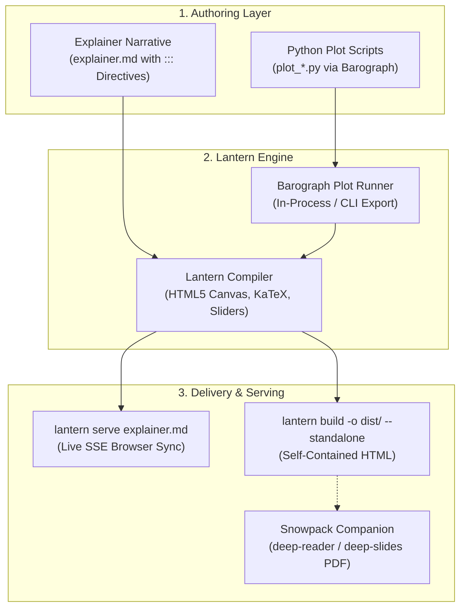

# Deep Interactive (Interactive Explainer & Simulation Dashboard Engine)

## Summary
Generates interactive, production-grade algorithmic explainer sites, live simulation dashboards, and Antigravity Artifacts powered by **Lantern** as the interactive web counterpart to **Snowpack**, with numerical simulation plots executed and extracted via **Barograph**. Binds high-level physical intuition, rich KaTeX mathematics, and Mermaid diagrams with live parameter sliders, HTML5 canvases, and Plotly visualizations.

## When to Use
- The user asks for an "interactive explainer", "visual deep-dive", "simulation dashboard", "interactive HTML demonstration", or "live parameter lab".
- An algorithm, dynamical system, or optimization scheme requires dynamic parameter exploration (e.g., interactive convergence walkers, penalty/barrier sliders, phase portrait zooming, live state metrics).
- The user wants a companion interactive web dashboard alongside static Snowpack PDFs (`deep-reader` / `deep-slides`).

## Operational Contract (🏛️ Deep / Production Compiler)
- **Web Counterpart to Snowpack**: Where `Snowpack` compiles static, publication-grade PDFs (Typst/LaTeX), `Lantern` compiles and serves dynamic, interactive web explainers (DOM, HTML5 Canvas, live parameter sliders, KaTeX math, Plotly embeds).
- **Barograph Separation of Concerns**: Python simulation scripts (`plot_*.py`) are executed and extracted via `Barograph`, while `Lantern` handles the Markdown narrative, live-reloading dev server, interactive widgets, and standalone HTML bundle compilation.
- **Live Preview Daemons**: Spawns `lantern serve explainer.md` (or Sled MCP `lantern_serve`) for real-time browser preview with server-sent events (SSE) auto-reload on file edits.
- **Standalone Delivery**: Compiles zero-dependency, self-contained single `.html` files via `lantern build explainer.md -o dist/ --standalone` (or Sled MCP `lantern_build`).

---

## Toolchain & Execution Pipeline



### Step 1: Write Standalone Python Plot Scripts (`plot_*.py`)
Write focused, self-contained Python plotting scripts adhering to Barograph protocols:
- Use standard **Plotly** (`fig = go.Figure()`) or **Matplotlib/Seaborn**.
- **Do NOT call `fig.show()` or `plt.show()`**; Barograph automatically discovers and extracts `fig`.
- Example (`plot_trajectory.py`):
  ```python
  import numpy as np
  import plotly.graph_objects as go
  from scipy.integrate import solve_ivp

  def dynamics(t, state):
      x, v = state
      return [v, -0.3 * v - np.sin(x)]

  t_eval = np.linspace(0, 20, 1000)
  sol = solve_ivp(dynamics, (0, 20), [2.5, 0.0], t_eval=t_eval)

  fig = go.Figure()
  fig.add_trace(go.Scatter(x=sol.t, y=sol.y[0], mode="lines", name="Angle θ(t)"))
  fig.add_trace(go.Scatter(x=sol.t, y=sol.y[1], mode="lines", name="Velocity ω(t)"))
  fig.update_layout(
      title="Nonlinear Pendulum Dynamics",
      xaxis_title="Time (s)",
      yaxis_title="State Amplitude",
      margin=dict(l=40, r=40, t=50, b=40),
  )
  ```

### Step 2: Compose Narrative & Interactive Directives (`explainer.md`)
Compose the document in `explainer.md` using Lantern's custom Markdown directives:

1. **`::: plot <script.py> [backend=plotly|svg] [height=500px]`**:
   Executes the plotting script via `barograph` and embeds the interactive Plotly div or vector SVG.
   ```markdown
   ::: plot plot_trajectory.py backend=plotly height=520px
   :::
   ```

2. **`::: canvas-walker [landscape=rosenbrock|ellipse|rastrigin|saddle] [algorithms=gd,armijo,newton,bfgs,momentum]`**:
   Injects a high-DPI HTML5 interactive canvas with real-time algorithm simulation, click-to-seed coordinate picker, and live readout metrics.
   ```markdown
   ::: canvas-walker landscape=rosenbrock algorithms=gd,armijo,newton,bfgs,momentum
   :::
   ```

3. **`::: barrier-vs-penalty`**:
   Injects an interactive constraint boundary lab with real-time penalty/barrier multiplier sliders and 2D contour + 1D slice plots.
   ```markdown
   ::: barrier-vs-penalty
   :::
   ```

4. **`::: callout type=[note|tip|warning|danger]`**:
   GitHub/Frost style alert boxes.
   ```markdown
   ::: callout type=tip
   Second-order methods like Newton-Raphson achieve quadratic convergence near the local optimum.
   :::
   ```

### Step 3: Launch Live Preview or Build Standalone HTML
* **Live Serving with Hot-Reload**:
  ```bash
  lantern serve explainer.md
  ```
  Or via Sled MCP tool `lantern_serve(path="explainer.md")`.
  Spawns the local HTTP server with automatic port discovery, watches Markdown and Python files, and pushes instant browser updates over SSE.

* **Production Standalone Compilation**:
  ```bash
  lantern build explainer.md -o dist/ --standalone
  ```
  Or via Sled MCP tool `lantern_build(path="explainer.md", out_dir="dist", standalone=True)`.
  Compiles a zero-dependency, single `.html` file ready for sharing, hosting, or embedding in Antigravity Artifacts.

### Step 4: Companion Static Deliverables via Snowpack
When presenting the work, link the interactive Lantern explainer directly to its static companion deliverables:
* Formal syllabus textbook chapter: [`deep-reader`](file:///home/usurper/Frost/home/configs/antigravity/skills/deep-reader/SKILL.md) (`snowpack report.md -m report`)
* 16:9 keynote presentation deck: [`deep-slides`](file:///home/usurper/Frost/home/configs/antigravity/skills/deep-slides/SKILL.md) (`snowpack slides.md -m slides`)
