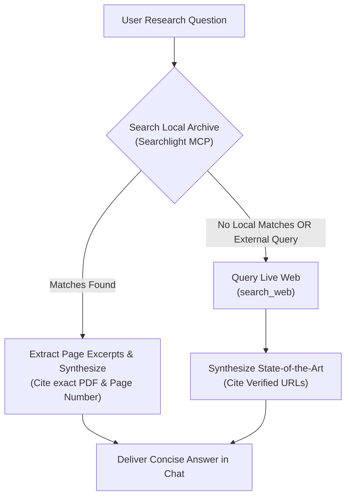

# Quick Research (Dual Local & Online Research Engine)

## Summary
A unified research assistant that bridges private local document archives (lecture slides, research papers, PDF books in `~/Documents`) with the live web. Designed to rapidly find exact definitions, formulas, and theorems with page-level citations, cross-referencing your professor's specific course conventions against state-of-the-art literature.

## When to Use
- The user asks to "find where this theorem was introduced", "search my papers for condition numbers", "what does the literature say about X?", or "explain how Y works".
- The user needs to verify whether a specific convention (e.g., metric sign convention, state-space matrix definitions) matches their course lecture slides.
- The user asks a technical or theoretical question that requires combining local archive evidence with upstream documentation.

## Operational Contract (⚡ Quick / In-Terminal)
- **Local Priority**: Always query local documents first via **Searchlight** MCP tools. Your course slides, professor notes, and project papers are the authoritative ground truth for conventions and exam requirements.
- **Online Augmentation**: If local search yields zero matches or the question pertains to external packages, recent arXiv preprints, or broad documentation, seamlessly trigger `search_web`.
- **Exact Citations**: Always provide clickable citations with exact document basenames and page numbers (e.g., `[Lecture_04.pdf (p. 14)](file:///home/usurper/Documents/Papers/Lecture_04.pdf)`) or verified web URLs.
- **Synthesized Delivery**: Deliver a concise, structured synthesis in the chat stream. Never dump hundreds of lines of unparsed PDF OCR text.

---

## Dual-Engine Execution Pipeline

### Stage 1: Local Discovery via Searchlight MCP
1. Execute `searchlight_search`:
   - Query target PDF directories (`~/Documents/`, course folders, or papers).
   - Use regex or keyword matching with context lines.
2. If matches exist, inspect metadata with `searchlight_info` or read surrounding context via `searchlight_extract_text` with targeted `first_page` and `last_page`.
3. Note exact page occurrences for clickable citation linking.

### Stage 2: Online Discovery via Web Search
1. If the query requires broader context, recent research, or upstream API docs, invoke `search_web`.
2. Cross-reference web results against local course conventions (highlighting discrepancies if your professor uses a non-standard notation).

### Stage 3: Structured Synthesis
Format the response with:
1. **Direct Answer**: Clear 2-3 sentence conceptual explanation.
2. **Key Excerpt & Formula**: The exact mathematical equation or definition quoted from the source.
3. **Citations Table**:
   | Source | Location / URL | Context |
   | :--- | :--- | :--- |
   | `Non_Linear_Prog.pdf` | Page 12, Lemma 3 | KKT second-order sufficiency condition |
   | `arXiv:2403.xxxxx` | Section 4.1 | Numerical barrier function implementation |
